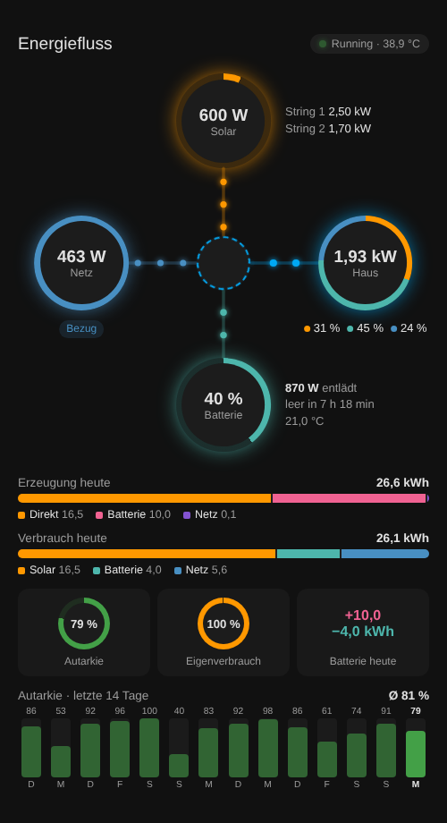

# Sungrow Energy Flow Card

[](https://hacs.xyz)
[](https://github.com/pasimatics/sungrow-energy-flow-card/actions/workflows/validate.yml)

Animated energy flow card for Home Assistant with **Sungrow hybrid inverters** (SH-RT series etc.) connected via **Modbus**.
It works out of the box with the entity names of the [mkaiser Sungrow Modbus integration](https://github.com/mkaiser/Sungrow-SHx-Inverter-Modbus-Home-Assistant) – no configuration needed.



## Features

- **Live power flow** between solar, grid, battery and house through the inverter – animated dots, speed scales with power
- **Solar**: total power, utilisation ring and power per MPPT string
- **Grid**: import / export with colour change
- **House**: ring split by source (solar / battery / grid) with percentages
- **Battery**: state of charge ring, charge/discharge power, temperature and estimated time until **full** or **empty**
- **Inverter status** and temperature in the header
- **Energy balance** for today, the last 7 or the last 30 days (switch with one tap): where the production went and where the consumption came from
- **Self-sufficiency** and **self-consumption** gauges, battery charged/discharged today
- **Production and consumption per day** as a bar chart – tap a day to see its exact values
- **Self-sufficiency history** for the last days, calculated from Home Assistant long-term statistics
- Uses the Home Assistant energy colours of your theme, works in light and dark mode
- German and English, chosen from your Home Assistant language
- Click any circle to open the entity's more-info dialog
- **Visual editor**: all options and entities can be set in the dashboard UI, no YAML needed

## Installation

### HACS (recommended)

[](https://my.home-assistant.io/redirect/hacs_repository/?owner=pasimatics&repository=sungrow-energy-flow-card&category=plugin)

1. Open **HACS** in Home Assistant and search for **Sungrow Energy Flow Card** – or use the button above
2. Click **Download**
3. Reload the browser (Ctrl+Shift+R)

If the card does not show up in the search yet, add it as a custom repository first:
HACS → ⋮ → **Custom repositories** → `https://github.com/pasimatics/sungrow-energy-flow-card`, category **Dashboard**.

### Manual

1. Download `sungrow-energy-flow-card.js` from the [latest release](https://github.com/pasimatics/sungrow-energy-flow-card/releases/latest)
2. Copy it to `/config/www/sungrow-energy-flow-card.js`
3. **Settings → Dashboards → ⋮ → Resources → Add resource**
   URL `/local/sungrow-energy-flow-card.js?v=1`, type **JavaScript module**

## Usage

```yaml
type: custom:sungrow-energy-flow-card
```

That's it if you use the mkaiser integration with its default entity names.

You can also add the card from the dashboard's **Add card** dialog and configure everything in the visual editor.
The editor shows the entities currently in use and only writes the values you change to the YAML.

### Options

| Option            | Default       | Description                                                                 |
| ----------------- | ------------- | --------------------------------------------------------------------------- |
| `title`           | `Energy flow` | Card title. `false` hides the header including the inverter status chip.    |
| `entities`        | see below     | Override single entity IDs.                                                 |
| `max_power`       | `10000`       | Power in W at which the flow animation reaches full speed and dot size.     |
| `pv_max`          | `10000`       | Peak PV power in W, used for the solar utilisation ring.                    |
| `animation_speed` | `1`           | Speed factor for the flow animation (`0.5` = half speed, `2` = double).     |
| `history_days`    | `14`          | Number of days in the self-sufficiency history. `0` hides it.               |
| `period_selector` | `true`        | Show the *Today / 7 days / 30 days* buttons above the energy balance.       |
| `daily_chart`     | `true`        | Show the production / consumption per day chart (follows the period).       |

### Entities

All keys are optional – only set the ones that differ from the defaults.

| Key                       | Default                                    | Unit  |
| ------------------------- | ------------------------------------------ | ----- |
| `pv_power`                | `sensor.total_dc_power`                    | W/kW  |
| `load_power`              | `sensor.load_power`                        | W/kW  |
| `grid_import_power`       | `sensor.import_power`                      | W/kW  |
| `grid_export_power`       | `sensor.export_power`                      | W/kW  |
| `battery_charge_power`    | `sensor.battery_charging_power`            | W/kW  |
| `battery_discharge_power` | `sensor.battery_discharging_power`         | W/kW  |
| `battery_soc`             | `sensor.battery_level`                     | %     |
| `battery_energy`          | `sensor.battery_charge`                    | kWh   |
| `battery_capacity`        | `sensor.battery_capacity_high_precision`   | kWh   |
| `battery_temperature`     | `sensor.battery_temperature`               | °C    |
| `inverter_state`          | `sensor.sungrow_inverter_state`            |       |
| `inverter_temperature`    | `sensor.inverter_temperature`              | °C    |
| `mppt1_power`             | `sensor.mppt1_power`                       | W/kW  |
| `mppt2_power`             | `sensor.mppt2_power`                       | W/kW  |
| `mppt3_power`             | `sensor.mppt3_power`                       | W/kW  |
| `mppt4_power`             | `sensor.mppt4_power`                       | W/kW  |
| `grid_power`              | –                                          | W/kW  |
| `battery_power`           | –                                          | W/kW  |
| `autarky`                 | –                                          | %     |
| `self_consumption`        | –                                          | %     |
| `daily_pv`                | `sensor.daily_pv_generation`               | kWh   |
| `daily_import`            | `sensor.daily_imported_energy`             | kWh   |
| `daily_export`            | `sensor.daily_exported_energy`             | kWh   |
| `daily_battery_charge_pv` | `sensor.daily_battery_charge_from_pv`      | kWh   |
| `daily_battery_discharge` | `sensor.daily_battery_discharge`           | kWh   |
| `daily_direct`            | `sensor.daily_direct_energy_consumption`   | kWh   |
| `total_import`            | `sensor.total_imported_energy`             | kWh   |
| `total_direct`            | `sensor.total_direct_energy_consumption`   | kWh   |
| `total_battery_discharge` | `sensor.total_battery_discharge`           | kWh   |
| `total_pv`                | `sensor.total_pv_generation`               | kWh   |
| `total_export`            | `sensor.total_exported_energy`             | kWh   |
| `total_battery_charge_pv` | `sensor.total_battery_charge_from_pv`      | kWh   |

The `total_*` sensors need long-term statistics (`state_class: total` or `total_increasing`) – they are used for the history and the 7/30 day totals.

Strings (`mppt*_power`) whose entity does not exist are simply not shown.
`grid_power` (positive = import, negative = export) and `battery_power` (positive = discharge, negative = charge) are optional signed sensors; when set they replace the separate import/export or charge/discharge sensors.
A negative house load (as reported by Fronius) is shown as a positive value.

### Missing daily or lifetime sensors

- **No daily sensor** (`daily_*`): today's value is calculated from the matching `total_*` counter – its current value minus its value at the end of yesterday from the long-term statistics.
- **No direct consumption counter**: direct consumption is derived as `PV production − export − battery charge`.
- **No battery sensors at all**: battery energy is treated as 0.
- **Self-sufficiency / self-consumption sensors** (`autarky`, `self_consumption`, optional, in %): used when the value cannot be calculated from the energy counters. Today shows the current sensor value, past days the daily mean from the long-term statistics, 7/30 days the average of the days.
- Anything that cannot be determined is shown as `–`.

### Example: Fronius

The Fronius integration only has lifetime energy counters and signed power values. With a smart meter and three strings:

```yaml
type: custom:sungrow-energy-flow-card
title: PV
entities:
  pv_power: sensor.solarnet_power_photovoltaics
  load_power: sensor.solarnet_power_load
  grid_power: sensor.solarnet_power_grid
  mppt1_power: sensor.pv_string_1_power
  mppt2_power: sensor.pv_string_2_power
  mppt3_power: sensor.pv_string_3_power
  inverter_state: sensor.inverter_status
  autarky: sensor.solarnet_relative_autonomy
  self_consumption: sensor.solarnet_relative_self_consumption
  total_pv: sensor.inverter_energy_total
  total_import: sensor.smart_meter_energy_real_consumed
  total_export: sensor.smart_meter_energy_real_produced
```

Entity IDs differ between installations – pick yours in the visual editor.
If only the PV total counter exists, the card shows production; consumption, self-sufficiency and self-consumption need grid import and export counters.
You can create them from the grid power with the **Integral (Riemann sum)** helper – e.g. from template sensors for the positive (import) and negative (export) part of `power_grid`.

### Example

```yaml
type: custom:sungrow-energy-flow-card
title: PV system
pv_max: 9800
animation_speed: 0.7
history_days: 30
entities:
  pv_power: sensor.my_pv_power
```

## How the numbers are calculated

```
consumption       = direct solar consumption + battery discharge + grid import
self-sufficiency  = (consumption − grid import) / consumption
self-consumption  = (PV production − grid export) / PV production
```

The current day uses the daily sensors. Past days (history and the 7/30 day totals) use the daily change of the `total_*` counters from Home Assistant's long-term statistics.
Battery time estimates are `stored energy / discharge power` and `(capacity − stored energy) / charge power`.
Without a `battery_energy` sensor, the stored energy is calculated as `state of charge × capacity`.

## License

[MIT](LICENSE)
