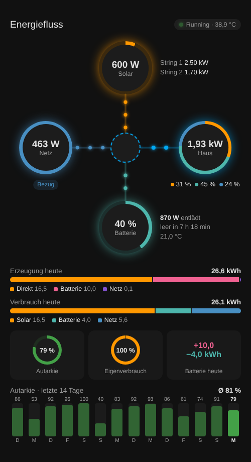

# Sungrow Energy Flow Card

[](https://hacs.xyz/docs/faq/custom_repositories)
[](https://github.com/pasimatics/sungrow-energy-flow-card/actions/workflows/validate.yml)

Animated energy flow card for Home Assistant with **Sungrow hybrid inverters** (SH-RT series etc.) connected via **Modbus**.
It works out of the box with the entity names of the [mkaiser Sungrow Modbus integration](https://github.com/mkaiser/Sungrow-SHx-Inverter-Modbus-Home-Assistant) – no configuration needed.



## Features

- **Live power flow** between solar, grid, battery and house through the inverter – animated dots, speed scales with power
- **Solar**: total power, utilisation ring and power per MPPT string
- **Grid**: import / export with colour change
- **House**: ring split by source (solar / battery / grid) with percentages
- **Battery**: state of charge ring, charge/discharge power, temperature and estimated time until **full** or **empty**
- **Inverter status** and temperature in the header
- **Daily balance**: where today's production went and where today's consumption came from
- **Self-sufficiency** and **self-consumption** gauges, battery charged/discharged today
- **Self-sufficiency history** for the last days, calculated from Home Assistant long-term statistics
- Uses the Home Assistant energy colours of your theme, works in light and dark mode
- German and English, chosen from your Home Assistant language
- Click any circle to open the entity's more-info dialog

## Installation

### HACS (recommended)

1. HACS → ⋮ → **Custom repositories**
2. Add `https://github.com/pasimatics/sungrow-energy-flow-card` with category **Dashboard**
3. Search for **Sungrow Energy Flow Card** and download it
4. Reload the browser (Ctrl+Shift+R)

### Manual

1. Download `sungrow-energy-flow-card.js` from the [latest release](https://github.com/pasimatics/sungrow-energy-flow-card/releases/latest)
2. Copy it to `/config/www/sungrow-energy-flow-card.js`
3. **Settings → Dashboards → ⋮ → Resources → Add resource**
   URL `/local/sungrow-energy-flow-card.js?v=1`, type **JavaScript module**

## Usage

```yaml
type: custom:sungrow-energy-flow-card
```

That's it if you use the mkaiser integration with its default entity names.

### Options

| Option            | Default       | Description                                                                 |
| ----------------- | ------------- | --------------------------------------------------------------------------- |
| `title`           | `Energy flow` | Card title. `false` hides the header including the inverter status chip.    |
| `entities`        | see below     | Override single entity IDs.                                                 |
| `max_power`       | `10000`       | Power in W at which the flow animation reaches full speed and dot size.     |
| `pv_max`          | `10000`       | Peak PV power in W, used for the solar utilisation ring.                    |
| `animation_speed` | `1`           | Speed factor for the flow animation (`0.5` = half speed, `2` = double).     |
| `history_days`    | `14`          | Number of days in the self-sufficiency history. `0` hides it.               |

### Entities

All keys are optional – only set the ones that differ from the defaults.

| Key                       | Default                                    | Unit  |
| ------------------------- | ------------------------------------------ | ----- |
| `pv_power`                | `sensor.total_dc_power`                    | W/kW  |
| `load_power`              | `sensor.load_power`                        | W/kW  |
| `grid_import_power`       | `sensor.import_power`                      | W/kW  |
| `grid_export_power`       | `sensor.export_power`                      | W/kW  |
| `battery_charge_power`    | `sensor.battery_charging_power`            | W/kW  |
| `battery_discharge_power` | `sensor.battery_discharging_power`         | W/kW  |
| `battery_soc`             | `sensor.battery_level`                     | %     |
| `battery_energy`          | `sensor.battery_charge`                    | kWh   |
| `battery_capacity`        | `sensor.battery_capacity_high_precision`   | kWh   |
| `battery_temperature`     | `sensor.battery_temperature`               | °C    |
| `inverter_state`          | `sensor.sungrow_inverter_state`            |       |
| `inverter_temperature`    | `sensor.inverter_temperature`              | °C    |
| `mppt1_power`             | `sensor.mppt1_power`                       | W/kW  |
| `mppt2_power`             | `sensor.mppt2_power`                       | W/kW  |
| `daily_pv`                | `sensor.daily_pv_generation`               | kWh   |
| `daily_import`            | `sensor.daily_imported_energy`             | kWh   |
| `daily_export`            | `sensor.daily_exported_energy`             | kWh   |
| `daily_battery_charge_pv` | `sensor.daily_battery_charge_from_pv`      | kWh   |
| `daily_battery_discharge` | `sensor.daily_battery_discharge`           | kWh   |
| `daily_direct`            | `sensor.daily_direct_energy_consumption`   | kWh   |
| `total_import`            | `sensor.total_imported_energy`             | kWh   |
| `total_direct`            | `sensor.total_direct_energy_consumption`   | kWh   |
| `total_battery_discharge` | `sensor.total_battery_discharge`           | kWh   |

The `total_*` sensors need long-term statistics (`state_class: total` or `total_increasing`) – they are used for the history.

### Example

```yaml
type: custom:sungrow-energy-flow-card
title: PV system
pv_max: 9800
animation_speed: 0.7
history_days: 30
entities:
  pv_power: sensor.my_pv_power
```

## How the numbers are calculated

```
consumption       = direct solar consumption + battery discharge + grid import
self-sufficiency  = (consumption − grid import) / consumption
self-consumption  = (PV production − grid export) / PV production
```

The current day uses the daily sensors. Past days in the history use the daily change of the `total_*` counters from Home Assistant's long-term statistics.
Battery time estimates are `stored energy / discharge power` and `(capacity − stored energy) / charge power`.

## License

[MIT](LICENSE)
